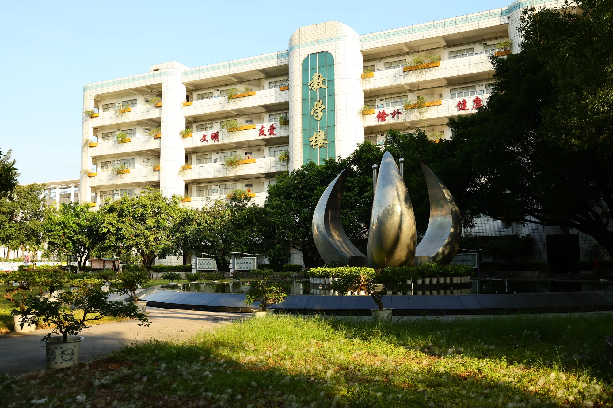

  

<h1 align="center">微光摄影社官网 · Glimmer Photography Agency</h1>

  
  
  

  <a href="https://lityzglimmer.top">🌐 在线浏览网站</a>　·　<a href="https://lityzglimmer.top/gallery.html">📷 直接进入作品集</a>

  <b>汇聚细碎光影，留存滚烫青春。</b> 
  以微小之姿看世界，以虔诚之姿定光影。

  

---

## 微光摄影社官网

柳铁一中**微光摄影社**的官方网站。社团拥有学校官方社团背书，但**由学生团队独立自主运营**——从拍摄、编辑、排版到上线部署，全部由社员自己完成。

网站取「明亮胶片感」的视觉语言：暖米白纸感背景、相纸白框、暗房红与暖金点缀，配合电影化的片头节奏，把一批社员原创实拍作品安放得安静而克制。

> 技术实现：前端为原生 HTML / CSS / JavaScript（无框架、无构建步骤）；作品投稿、报名与管理后台由 Vercel Serverless 接口、腾讯云 COS 图片存储与 Supabase 数据库支撑，git push 即自动部署。

---

## 你会看到什么

网站按题材分为四个板块，目前共 **74 张**社员原创实拍作品：

| 板块 | 内容 |
| --- | --- |
| **校园纪实** | 高三喊楼的声浪、运动会的奔跑、校园四季的光影 |
| **校外采风** | 玉武三江的侗寨风雨桥、云雾梯田、赶集的人与采茶的少年 |
| **城市与远方** | 柳州街巷、柳江落日、山野与远方 |
| **人像与视觉** | 国风写真、自然光与逆光、舞台纪实、校园互拍（21 张） |

所有作品均为**社员原创实拍**，带有「微光」水印，禁止搬运与商用。

---

## 怎么逛这个网站

- **首页**：电影感大图轮播，顶部一条**招新状态条**（招新中直接去报名，结束后引导加 QQ 群等通知），四大板块的精选作品，「最新收录」里能看到同学刚通过审核的投稿，还有一块**近期动态**说清社团最近在忙什么，以及社团自成立以来的「运行时长」计时器。
- **作品集**：按板块筛选作品，向下滚动分批加载；筛选栏右侧常驻**投稿入口**。点开任意一张即可进入灯箱，**查看大图与拍摄信息**（机型、镜头、光圈、快门、ISO、焦段），并可**一键复制这张作品的专属链接**——发给同学，点开就是那一张。新投稿通过审核后会自动出现在这里。
- **作品投稿**：同学自助投稿通道——选分类、填标题与署名、选图上传，浏览器自动压缩、自动读取拍摄参数后经服务端写入，干部审核通过即带着署名上线；投稿后还能在页尾自查审核进度。
- **关于我们**：社团的来历、创作理念、**四个部门的逐一介绍**，以及「零门槛、不唯设备」的招新态度与招募说明。
- **加入微光**：报名方式、入社流程与常见问题；报名信息一键提交进社团报名库，无需再手动转发，报名后还能**自查「待联系 / 已联系」**。
- **分享微光**：官方抖音与官方 QQ 的关注入口（附二维码），以及把本站分享出去的方式。
- **页脚**：官方 QQ 群号与抖音号就放在这里，**点一下直接复制**——想加群、想问问题，不用再到处翻。

网站适配手机与平板，在任意屏幕宽度下都能完整浏览。

---

## 体验亮点

- **电影感 Hero 轮播**：首页大图缓慢推近（Ken Burns），交叉淡入，不抢内容。
- **瀑布流作品集**：横竖构图混排自适应，比例经过统一钳制，版面不参差。
- **投稿即上线**：同学在前端选图后自动压缩（约 300KB）、自动带上拍摄参数，经服务端写入云端存储，作品进「待审核」队列；干部在管理后台一键通过，作品集即刻更新，署名同步展示。
- **分类筛选 + 灯箱**：按板块快速定位；灯箱里除了大图，还会展示这张照片的拍摄参数。
- **作品可以单独分享**：灯箱里一键复制这张作品的专属链接，发进群里点开就是那一张。
- **一进站就知道能不能报名**：首页顶部招新状态条，招新期间直达报名表，结束后引导加官方 QQ 群等通知；报名之后还能自查「待联系 / 已联系」。
- **「运行时长」实时计时器**：自 2016-09-10 起实时走动，年 / 天 / 时 / 分 / 秒分层呈现，里程表式滚动。
- **胶片颗粒质感**：全局细微噪点覆膜，模拟胶片纹理。
- **响应式**：从桌面到手机，版式、字号、间距随屏幕自然收放。

---

## 更新记录

> 版本号规则：小修小补递增末位（如 1.4.1、1.4.2）；重大更新会以更醒目的方式呈现。

---

### v2.0.8 · 2026-10-25 · 投稿来源拦截修复

- **修复**｜有同学反馈投稿时报「**来源不受支持**」。排查发现接口的来源校验过于严格：只认 `https://` 的本站域名，从 `http://`、带端口、本地调试或镜像域打开页面时，投稿会被误拦。现已放宽——**只拦截明确来自外部网站的请求**，`http`、任意端口、任意层级子域、Vercel 部署域与本地调试一律放行；被拦时报错会带上收到的来源，截图即可定位。
- **优化**｜投稿失败的提示现在会附带**页面地址**，以后遇到上传问题一眼就能看出是从哪个域打开的，不用再猜。
- 说明：投稿与报名另有限流、全局熔断、图片格式校验与人工审核多重防护，来源检查只是最外层的一道，不影响正常使用。

---

### v2.0.7 · 2026-10-25 · 招新提示收进首屏

- **优化**｜首页的招新提示改成首屏里的一枚**小胶囊**，和「2026 · 校园影像记录计划」排在同一行，点一下直接去报名。原来那条横贯整屏的深色横带会把首屏画面从中间切断、像贴片广告，现在画面完整了；窄屏时胶囊自动换到下一行，不挤。

---

### v2.0.6 · 2026-10-25 · 首屏适配与动态精简

- **修复**｜首页顶部招新条插入后，首屏大图没有连它一起铺满，导航的白字会压在一段浅色底上、几乎看不清——现在首屏始终顶到页面最上方，导航稳稳落在画面上。
- **优化**｜「近期动态」去掉日期行，只保留状态与内容，版面更干净，也不会因为日期过时而显得陈旧。

---

### v2.0.5 · 2026-10-25 · 让同学更容易找到组织

- **新增**｜首页顶部**招新状态条**：招新季直接引导去填报名表，招新结束则引导加官方 QQ 群等通知——同学一进站就知道现在能不能报名。
- **新增**｜首页**近期动态**：社团最近在忙什么（招新、喊楼记录、外拍采风）一眼可见，网站不再只有静态的作品陈列。
- **新增**｜**报名状态自查**：报名后可以用姓名与联系方式查「待联系 / 已联系」，不用干等；报名成功页也写明了「招新期间通常 3 天内联系」的预期。
- **新增**｜**灯箱复制作品链接**：点开任意一张作品即可复制它的专属链接，甩进 QQ 群点开就是那一张——同学自己的作品更容易被看见、被转发。
- **优化**｜**页脚联系方式可点击复制**：官方 QQ 群号与抖音号直接放在页脚，点一下就复制，不用再翻页面找。
- **优化**｜**投稿入口前置**：导航新增「投稿」，作品集筛选栏右侧常驻「投稿我的作品」按钮——已入社的同学想投稿，不用再翻到页面底部。
- **新增**｜**404 页面**：地址敲错时不再是英文默认页，而是一句「这束微光走丢了」＋ 回首页、看作品集、加入微光的入口。

---

### v2.0.4 · 2026-10-25 · 省流量 · 拍摄参数 · 自动备份

- **优化**｜作品集网格、首页「最新收录」与管理后台缩略图改用**云端缩图**（按宽度缩放，880 / 640 / 400px），只有点开大图才加载原图——手机上逛作品集流量省一大截；存储桶未开通图片处理时参数会被忽略、自动回退原图，页面不受影响。
- **新增**｜投稿自动读取**拍摄参数**：选好图片后即时从原图解析机型、镜头、光圈、快门、ISO、焦段与拍摄日期，随作品一起提交；审核通过后，这些信息会出现在作品集灯箱的拍摄信息行里（照片里没有参数信息不影响投稿）。
- **新增**｜**月度自动备份**：每月 1 日自动把作品与报名记录导出成表格文件、存入云端存储的备份目录并推送通知——免费数据库没有自动备份，这样即使数据库项目出问题也能找回全部记录；后台里也可以随时手动「立即备份」。
- **优化**｜清理已被取代的上传凭证接口，投稿写入统一走服务端转发通道——接口更少，攻击面更小。

---

### v2.0.3 · 2026-10-25 · 安全加固与首页联动

- **新增**｜首页「**最新收录**」：通过审核的新投稿自动出现在首页（最多 6 张），点击直达作品集里对应的作品；接口不可用时自动隐藏，不影响首页其它内容。
- **新增**｜管理后台**防暴力破解**：同一 IP 连续输错 5 次密码锁定 10 分钟，输对即清零。
- **优化**｜投稿上传增加**孤儿图回删**：万一图片写入成功但信息入库失败，自动删掉刚传的图，不在存储里留垃圾。
- **新增**｜**接口异常推送**：投稿 / 报名 / 后台接口出错时自动推送到干部微信（同一 IP 10 分钟最多 3 条，防刷屏；未配置通知地址时静默跳过）。
- **优化**｜Serverless 函数区域调整到**香港**：全站接口延迟从约 200ms 降到几十毫秒。

---

### v2.0.2 · 2026-10-25 · 审核体验与防滥用

- **优化**｜管理后台缩略图支持**点击放大**（宽版浮层）：审核作品时能看清画面细节，不用对着小图猜。
- **新增**｜投稿与报名**防滥用多层防护**：单 IP 频率限制（10 分钟 15 次）、全局熔断（异常流量自动拒绝并提示稍后再试）、JPG 文件魔数校验、蜜罐字段、跨站表单拦截——层层设防，正常使用完全无感。配合既有的「先审后发」机制，不良内容到不了公开页面。

---

### v2.0.1 · 2026-10-24 · 管理增强

- **新增**｜**投稿进度自查**：投稿页可用「作品标题 + 署名」查询审核状态，通过后直接给出作品链接，同学不用再跑来问干部。
- **新增**｜**批量审核**：待审核区支持全选后一键批量通过 / 删除，招新季一次来几十张也不慌。
- **新增**｜**作品下架与编辑**：已发布作品可「下架」（数据与图片保留、前台不可见、随时恢复），也可直接编辑标题 / 署名 / 分类 / 拍摄日期，不用删了重投。
- **新增**｜**报名管理增强**：按「全部 / 未联系 / 已联系」筛选，一键标记已联系；导出报名 CSV 增加「是否已联系」列，另支持导出全部投稿 CSV。
- **新增**｜**新消息推送**：配置 `NOTIFY_URL` 后，有新投稿 / 新报名时自动推送到干部微信（未配置则静默跳过，不影响任何功能）。
- **新增**｜**定时保活**：每周自动访问一次数据库接口，根治 Supabase 免费项目「7 天无访问被暂停」的问题。
- **调整**｜投稿页新增「本人原创实拍」必选确认，投稿前多一道自律关卡。
- **调整**｜投稿上传通道改为**经服务端转发**（压缩仍在浏览器完成）：浏览器直传对象存储时，预检请求在部分网络/浏览器环境下会被拦，同源转发彻底绕开跨域限制，签名与密钥也全程不离开服务端。

---

### 🌟 v2.0.0 · 2026-10-24 · 重大更新：网站有了「后台」

> 从「一个展示相册」变成「一个能运转的社团站点」：作品投稿、审核发布、报名入库、管理后台全部上线。

- **新增**｜**作品投稿通道**（投稿页）：选分类、填标题与署名、选图即传——浏览器先把图片自动压缩到约 300KB 再直传云端存储，原图留在社员自己手里，投稿无需再经手任何人。
- **新增**｜**作品集与投稿打通**：投稿先进入「待审核」，干部一键通过后自动带着署名出现在作品集，分类计数同步更新；万一接口不可用，作品集自动回退为原有作品，页面不白屏。
- **新增**｜**报名直接入库**（加入微光页改造）：新生的报名信息一键提交进数据库，负责人在后台即可查看、导出 CSV；网络异常时自动回退为「生成报名文本手动转发」，怎么都不耽误报名。
- **新增**｜**管理后台**：单密码登录（密码只存在服务端，可随时更换），支持待审核列表、审核通过、删除作品（数据库与云端图片一并清理）、报名列表与 CSV 导出。
- **架构**｜Vercel Serverless 接口 + 腾讯云 COS 图片存储 + Supabase 数据库，图片走国内节点、访问低延迟；**所有密钥只存放在 Vercel 环境变量，源码与 GitHub 仓库中零密钥**。
- **说明**｜域名与 DNS 未做任何改动，部署方式不变（git push 自动上线）。

---

### v1.4.5 · 2026-10-01

- **调整**｜作品「雕塑光影」更名为「**校有萌猫**」（城市与远方）。
- **调整**｜作品「市集红蛋」更名为「**集市茶香**」（玉武三江）。
- **下架**｜隐藏作品「城市黄昏」（城市与远方）与「少女 · 黑衫」（人像）：条目改 `hidden: true`，数据与图片保留备用，作品集列表、分类计数与首页精选均已同步，**当前展出 74 张**。
- **修正**｜首页 Hero 第三屏文案「柳州 · 柳江之上」更正为「日落·龙江河之上」（龙江河不在柳州，去掉柳州前缀、保留河名与日落场景，与 hero-city.webp / city-01 同素材一致）；关于页配图说明「柳江落日」同步更正为「龙江河」。

### v1.4.4 · 2026-10-01

- **调整**｜作品「柳江落日 · 群峰剪影」更名为「**龙江河**」、「（红桥）龙江河」更名为「**文惠桥**」（城市与远方）——更正此前误记。
- **调整**｜作品「红竹笼」更名为「**茶罐 · 一味三江**」（玉武三江）——画面上铁罐印的「罐装你的梦想 / 追梦少年·三江研学」为照片内置文案，随图呈现。
- **调整**｜下架作品「晨光里的广场」（校园四季）与「蓝天白云」（城市与远方）：条目改为隐藏，数据与图片保留备用，作品集列表、分类计数与首页精选均已同步，**当前展出 76 张**。
- **优化**｜新增统一的「可见作品」出口（`works.js` 里的 `hidden: true` 即下架，无需改动各页面渲染逻辑），页头「本期展出」数量改为按实际可见作品自动计算。

### v1.4.3 · 2026-09-27

- **新增**｜社交分享预览：全部页面配置 Open Graph / Twitter Card 标签 + 1200×630 分享封面图（`assets/img/brand/og-cover.jpg`），把链接发到微信、QQ、抖音等平台时会显示标题、简介与封面卡片。
- **新增**｜搜索引擎基础：新增 `robots.txt` 与 `sitemap.xml`，首页加入 `Organization` 结构化数据（JSON-LD）。
- **修复**｜统一各页 `canonical` 与分享地址指向正式域名 `https://lityzglimmer.top`。

### v1.4.2 · 2026-09-27

- **修复**｜抖音二维码重新裁切：此前裁得过紧、切到码盘外圈导致扫不出；本次完整保留整个码盘并补足四周留白，可正常扫码。
- **调整**｜「分享微光」页移除「复制分享文案」按钮，仅保留「复制本站链接」。
- **调整**｜QQ 二维码下方注明「请使用 QQ 扫一扫」；渠道标题去掉重复的「官方 QQ」。

### v1.4.1 · 2026-09-27

- **修复**｜抖音二维码在页面上过小、不易扫出——整体放大并支持点击放大查看，方便手机扫码。
- **修复**｜「复制本站链接 / 复制分享文案」在本地双击打开（file://）时无法复制——改为优先使用系统剪贴板、失败自动兜底，本地与线上都能用。
- **调整**｜官方 QQ 二维码更换为最新版；移除「加为好友」跳转按钮，统一改为扫码添加。
- **调整**｜「分享微光」页移除「分享到 QQ」入口，保留复制链接与复制分享文案。

### v1.4.0 · 2026-09-27

- **新增**｜「关于我们」新增「我们的部门」板块：摄影部、模特部、组织部、文编部四个部门的定位与工作内容逐一介绍。
- **新增**｜「关于我们」新增「招新」板块：招募对象、招新时间与报名方式一次说清，并接入官方 QQ 与抖音。
- **新增**｜独立页面「分享微光」：官方抖音（ltyz_GLIMMER）与官方 QQ（1159554310）的关注入口、二维码，以及一键分享到 QQ / 复制链接与分享文案的功能。
- **新增**｜导航与页脚新增「分享微光」入口。
- **新增**｜传播与版权说明：欢迎分享转发，请保留署名，禁止搬运、二改与商用。

### v1.3.0 · 2026-09-26

- **新增**｜人像作品第二批次上线：18 张社员原创实拍，站点作品总数增至 **78 张**、人像增至 21 张；首页新增「人像与视觉」独立板块。
- **新增**｜灯箱展示拍摄信息：自动读取每张照片的机型、镜头、光圈、快门、ISO、焦段与日期。
- **优化**｜首页大图轮播与作品灯箱的图片切换更顺滑，消除切换时的二次跳动。
- **优化**｜玉武三江板块主视觉替换为风雨桥上的迎宾队伍实拍。

### v1.2.0 · 2026-09-26

- **新增**｜「运行时长」实时计时器（关于页），自社团成立起实时走动，年 / 天 / 时 / 分 / 秒分层展示。
- **优化**｜计时器数字滚动顺序与流畅度修正，读数稳定不跳变。

### v1.1.0 · 2026-09-25

- **优化**｜作品替换为带水印版本，呈现更完整。

### v1.0.0 · 2026-09-25

- **新建**｜微光摄影社官网首版上线：首页 / 作品集 / 关于我们 / 加入微光四页，社团原创实拍作品上线。

---

## 声明

- 微光摄影社所有平台（抖音、官网、作品展示渠道）均为**学生自主运营**，拥有学校社团背书，**不属于学校官方平台**。所有内容、作品、活动、文案均由学生团队独立策划、拍摄、制作与负责。
- 站内全部作品为**社员原创实拍**，禁止搬运、二改与商用。

---

Designed & built by 柳铁一中微光摄影社 · 学生团队自主运营
